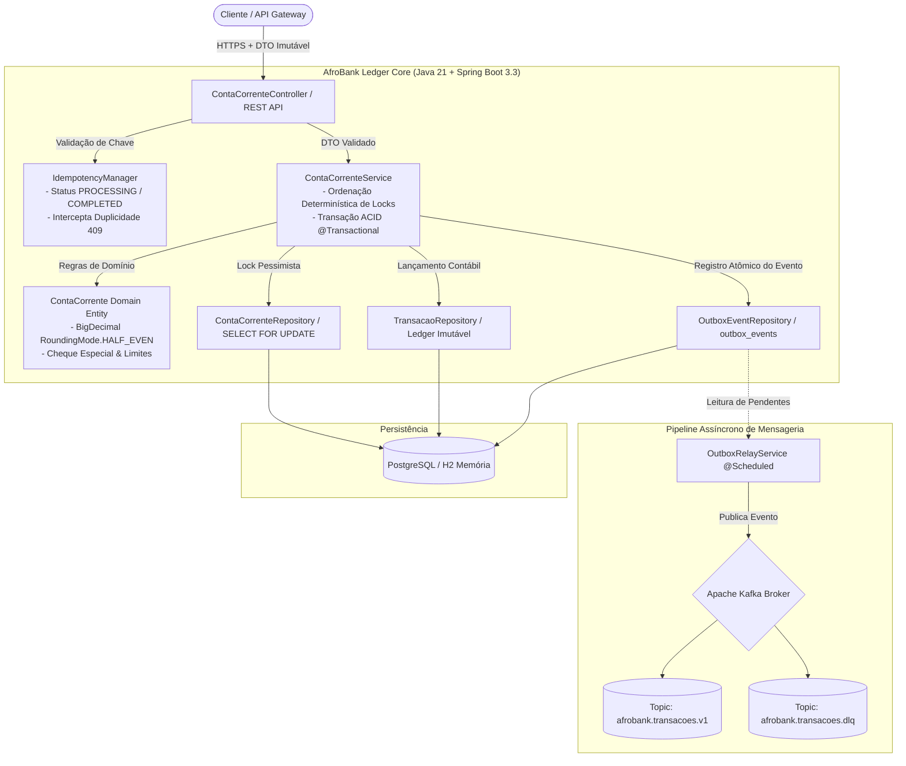
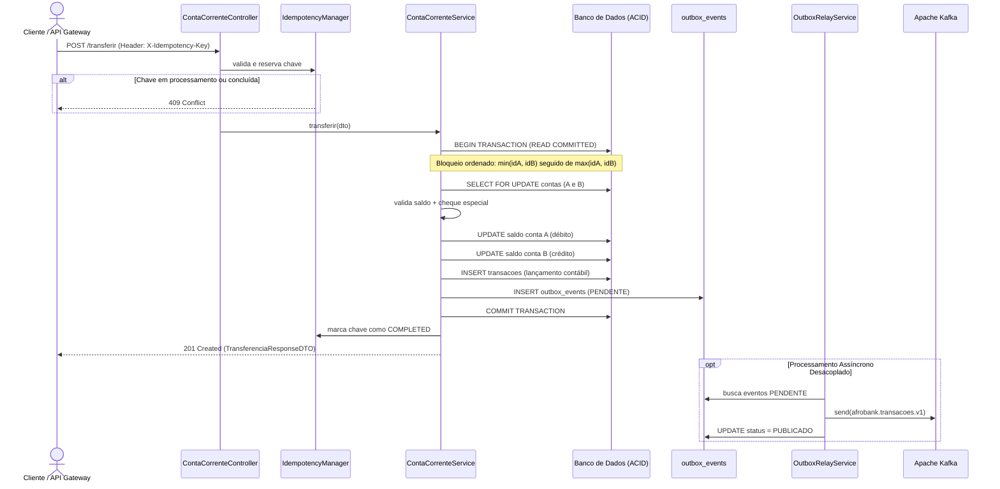
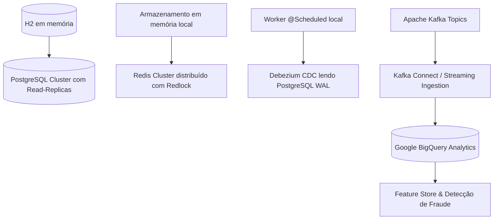

# AfroBank Ledger

Aplicação backend desenvolvida para livro-razão financeiro e processamento de contas correntes: gestão de saldos e limites de cheque especial, liquidação atômica de transferências entre contas, prevenção ativa de deadlocks via ordenação lexicográfica de locks, controle de concorrência com chave de idempotência e propagação assíncrona de eventos transacionais via Transactional Outbox Pattern com Apache Kafka e Dead Letter Queue (DLQ).

O foco do projeto é manter **consistência contábil por partidas dobradas**, **respostas previsíveis sob alta concorrência simultânea** e um **caminho explícito de evolução para infraestrutura analítica e detecção de risco**.

---

## Stack Tecnológica

- **Backend:** Java 21 LTS, Spring Boot 3.3.5, Spring Data JPA, Hibernate, Spring Security Crypto (`BCryptPasswordEncoder`).
- **Persistência:** PostgreSQL (perfil de produção) e H2 Database (em memória para execução local e testes rápidos sem dependências externas).
- **Concorrência & Cache:** Lock pessimista ordenado a nível de banco de dados (`SELECT FOR UPDATE`), lock otimista (`@Version`) e gerenciador de idempotência distribuída.
- **Assíncrono & Eventos:** Transactional Outbox Pattern, worker agendado (`@Scheduled`), integração com Apache Kafka e tópico de contingência (DLQ).
- **Qualidade & Testes:** JUnit 5, Mockito, AssertJ, Spring MockMvc.
- **DevOps & Containers:** Docker (build multi-stage com imagem Eclipse Temurin JRE 21 e usuário non-root), GitHub Actions (esteiras multi-ambiente: DEV, HOM e PROD).

---

## Execução Rápida

**Pré-requisitos:** Java 21 LTS instalado. O Maven Wrapper incluído no repositório baixa a versão do Maven e as dependências de compilação automaticamente.

```bash
# 1. Executar a suíte de testes unitários e de integração
./mvnw clean test

# 2. Iniciar a aplicação localmente (perfil padrão em memória)
./mvnw spring-boot:run
```

### URLs de Acesso

| Serviço | URL | Descrição |
| :--- | :--- | :--- |
| **API REST Contas** | [http://localhost:8080/api/v1/contas-corrente](http://localhost:8080/api/v1/contas-corrente) | Endpoints de consulta, depósito, saque e transferência |
| **API REST Clientes** | [http://localhost:8080/api/v1/clientes](http://localhost:8080/api/v1/clientes) | Cadastro e consulta de clientes titulares |
| **Health Check** | [http://localhost:8080/actuator/health](http://localhost:8080/actuator/health) | Diagnóstico de integridade da aplicação (Spring Boot Actuator) |

---

## Arquitetura e Decisões

### Diagrama de Fluxo e Componentes



### Diagrama de Sequência: Ciclo de Vida da Transferência Atômica



---

## Detalhamento das Regras de Negócio e Segurança

### 1. Prevenção de Deadlocks por Ordenação Determinística de Recursos
Em transferências simultâneas com contas cruzadas (exemplo: Thread 1 transfere de A para B enquanto a Thread 2 transfere de B para A), bloqueios adquiridos na ordem de chegada geram condições de travamento mútuo (*deadlocks*).
* **Solução:** O `ContaCorrenteService` adquire os bloqueios pessimistas (`SELECT FOR UPDATE`) ordenando os IDs de forma crescente:
  $$\text{lock}(\min(id_A, id_B)) \longrightarrow \text{lock}(\max(id_A, id_B))$$
* **Resultado:** Como todas as threads competidoras requisitam os recursos na mesma sequência numérica, o entrelaçamento circular é eliminado a nível de banco de dados.

---

### 2. Precisão Monetária sem Ponto Flutuante
* É proibido o uso de `float` e `double` para representar saldo, limites e movimentações financeiras, evitando imprecisões decorrentes da representação binária IEEE 754.
* Os valores utilizam `BigDecimal` com escala fixada em duas casas decimais e modo de arredondamento bancário `RoundingMode.HALF_EVEN` (arredondamento para o par mais próximo, eliminando viés cumulativo estatístico).

---

### 3. Idempotência em Mutações Financeiras
Para proteger a operação contra retentativas de rede e cliques repetidos:
* O endpoint `POST /api/v1/contas-corrente/transferir` suporta o cabeçalho `X-Idempotency-Key` (UUIDv4).
* O `IdempotencyManager` reserva a chave atomicamente com status `PROCESSING`.
* Se a mesma chave for reenviada durante o processamento ou após a conclusão, o sistema rejeita a segunda chamada com `409 Conflict`, impedindo duplicações de débito.

#### Como testar a transferência com chave de idempotência:

```bash
# 1. Primeira chamada (execução bem-sucedida)
curl -i -X POST http://localhost:8080/api/v1/contas-corrente/transferir \
  -H 'Content-Type: application/json' \
  -H 'X-Idempotency-Key: c9b8e1a2-3f4d-4e5a-8b9c-0d1e2f3a4b5c' \
  -d '{
    "contaOrigemId": 1,
    "contaDestinoId": 2,
    "valor": 150.00
  }'

# 2. Segunda chamada imediata com a mesma chave (rejeição por idempotência)
curl -i -X POST http://localhost:8080/api/v1/contas-corrente/transferir \
  -H 'Content-Type: application/json' \
  -H 'X-Idempotency-Key: c9b8e1a2-3f4d-4e5a-8b9c-0d1e2f3a4b5c' \
  -d '{
    "contaOrigemId": 1,
    "contaDestinoId": 2,
    "valor": 150.00
  }'
```

* **Resposta esperada na 1ª chamada:** `201 Created` com os dados do comprovante.
* **Resposta esperada na 2ª chamada:** `409 Conflict` contendo o payload RFC 7807 indicando conflito de idempotência.

---

### 4. Partidas Dobradas e Rastreabilidade Contábil
* Saldo bancário não é atualizado isoladamente. Cada movimentação exige contrapartida correspondente.
* Toda transferência gera um registro persistido na tabela `transacoes` contendo ID de origem, ID de destino, valor, carimbo de data/hora e identificador único de liquidação.

---

## Notificações Assíncronas (Transactional Outbox Pattern e Apache Kafka)

Para solucionar o problema de escrita dupla (*Dual-Write*) e garantir que indisponibilidades no broker de mensageria não quebrem a consistência do banco de dados relacional:

1. **Persistência Atômica:** Quando a transferência é confirmada, o evento de domínio `TransferenciaRealizadaEvent` é serializado em JSON e gravado na tabela `outbox_events` na mesma transação SQL que debita e credita as contas.
2. **Despacho em Background:** O componente `OutboxRelayService` pesquisa periodicamente os eventos com status `PENDENTE`.
3. **Publicação no Kafka:** As mensagens são publicadas no tópico `afrobank.transacoes.v1` utilizando o identificador da conta como partição de chave (garantindo ordenação sequencial por conta).
4. **Tratamento de Contingência (DLQ):** Caso a publicação falhe consecutivamente por 3 tentativas, o status é alterado para `FALHA_DLQ` e o evento é roteado para o tópico de contingência `afrobank.transacoes.dlq`.

---

## Tratamento Padronizado de Erros

O componente `GlobalExceptionHandler` intercepta exceções em tempo de execução e produz respostas padronizadas em conformidade com a especificação **RFC 7807 (ProblemDetail)**:

```json
{
  "type": "https://afrobank.tech/errors/saldo-insuficiente",
  "title": "Saldo Insuficiente",
  "status": 422,
  "detail": "Saldo insuficiente na conta 001-A. Disponivel: 50.00, Solicitado: 100.00",
  "instance": "/api/v1/contas-corrente/transferir",
  "timestamp": "2026-11-22T21:00:00Z"
}
```

Códigos tratados pela camada:
- `400 Bad Request`: Falha de validação em campos de entrada (Bean Validation).
- `404 Not Found`: Conta ou cliente inexistente.
- `409 Conflict`: Violação de unicidade ou reutilização de chave de idempotência.
- `422 Unprocessable Entity`: Violação de regra de saldo ou limite de cheque especial.
- `500 Internal Server Error`: Erros não previstos com ocultação de dados sensíveis de stack trace.

---

## Testes e Validação da Solução

```bash
# Executa a suíte de testes automatizados com o Maven Wrapper
./mvnw clean test
```

**Cenários cobertos pela suíte (17 testes automatizados):**
- **Domínio (`ContaCorrenteTest`):** Validação de crédito com precisão decimal, débito no saldo próprio, consumo do cheque especial, rejeição de transação além do limite e proibição de valores negativos ou nulos.
- **Serviço (`ContaCorrenteServiceTest`):** Liquidação atômica de transferência entre contas, gravação simultânea na Outbox, bloqueio de transferência para a própria conta e tratamento de saldo insuficiente.
- **Idempotência (`IdempotencyManagerTest`):** Liberação de chave inédita, rejeição de chave duplicada com `IdempotencyException` e tratamento de chaves em branco.
- **Relé Assíncrono (`OutboxRelayServiceTest`):** Despacho de mensagens pendentes com transição para `PUBLICADO` e encaminhamento para DLQ após esgotamento de tentativas.
- **Controlador REST (`ContaCorrenteControllerTest`):** Contratos de API via MockMvc, retorno `201 Created`, validação de payload inválido (`400 Bad Request`), saldo insuficiente (`422 Unprocessable Entity`) e conflito de idempotência (`409 Conflict`).

---

## Limites Conhecidos e Roadmap de Produção



Itens estruturados para expansão em cenários de alta volumetria:
* **Persistência Relacional:** Migração do perfil local para PostgreSQL Cluster gerenciado com particionamento de tabelas contábeis por período.
* **Idempotência Distribuída:** Substituição do armazenamento local de idempotência por Redis Cluster com expiração automática por TTL.
* **Captura de Dados em Tempo Real (CDC):** Substituição do polling de outbox por Debezium lendo diretamente o Write-Ahead Log (WAL) do PostgreSQL para envio ao Kafka com menor sobrecarga de banco.
* **Base Analítica e IA:** Ingestão contínua de eventos do Kafka no **Google BigQuery** para alimentação de **Feature Store**, viabilizando modelos de score de crédito dinâmico e prevenção a fraudes em tempo de inferência reduzido.

---

## Autoria

**Juliana Chaves Palm**  

[](https://linkedin.com/in/julianachavespalm)
[](https://github.com/julianachavespalm)
