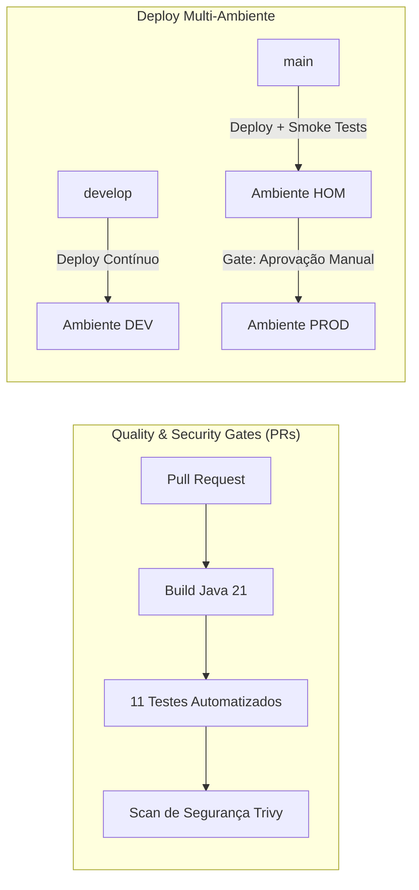

<div align="center">

# AfroBank Ledger

### Livro-Razão Financeiro de Alta Confiabilidade, Concorrência Distribuída e Integridade Transacional

[](https://openjdk.org/)
[](https://spring.io/projects/spring-boot)
[](#-esteiras-de-cicd--governanca)
[](LICENSE)

</div>

---

## 📌 Visão Geral

O **AfroBank Ledger** (`afrobank-ledger`) é o microsserviço central de **livro-razão contábil e processamento transacional** do AfroBank. Projetado sob princípios de **Clean Architecture**, **Domain-Driven Design (DDD)** e rigor contábil de partidas dobradas (*double-entry bookkeeping*), o serviço é responsável por garantir a integridade absoluta dos saldos, prevenção contra *double spending* e eliminação matemática de *deadlocks* em cenários de alta concorrência.

---

## 🏛️ Arquitetura do Serviço


---

## ⚡ Engenharia de Concorrência & Resiliência Financeira

### 1. Prevenção de Deadlocks por Ordenação Determinística de Recursos
Em transferências simultâneas entre contas cruzadas (ex: Thread 1 transfere de A para B; Thread 2 transfere de B para A), sistemas ingênuos bloqueiam recursos em ordem de chegada, gerando **Deadlocks clássicos**.
- **Solução no AfroBank Ledger:** Os bloqueios pessimistas (`SELECT FOR UPDATE`) são sempre adquiridos ordenados pelo menor ID primeiro:
  $$\text{lock}(\min(id_A, id_B)) \longrightarrow \text{lock}(\max(id_A, id_B))$$
  Isso elimina qualquer possibilidade de entrelaçamento circular de threads.

### 2. Precisão Monetária Absoluta
- **Eliminação do ponto flutuante:** Proibição de tipos `float` e `double` para manipulação monetária.
- **`BigDecimal` com escala explícita:** Operações com 2 casas decimais e modo de arredondamento bancário `RoundingMode.HALF_EVEN` (arredondamento para o par mais próximo, minimizando viés cumulativo estatístico).

### 3. Partidas Dobradas & Trilha de Auditoria
- Toda mutação de saldo gera um registro imutável na tabela `transacoes`, viabilizando conciliação contábil e auditoria financeira ponta a ponta.

---

## 🚀 Esteiras de CI/CD & Governança

O repositório possui esteiras automatizadas multi-ambiente no **GitHub Actions**:



- **`ci.yml`**: Compilação, suíte completa de testes unitários e de integração com upload de relatórios Surefire e análise de vulnerabilidades com **Trivy**.
- **`cd-dev.yml`**: Build de imagem container Docker e deploy contínuo em ambiente de desenvolvimento.
- **`cd-hom.yml`**: Deploy em homologação com execução de *smoke tests*.
- **`cd-prod.yml`**: Release produtivo protegido por **Required Reviewers (aprovação manual obrigatória)** no GitHub Environments.

---

## 🧪 Pirâmide de Testes Automatizados

O projeto conta com cobertura automatizada em múltiplas camadas:

```
                  ┌──────────────────────┐
                  │    Controller Test   │  API MockMvc / RFC 7807 ProblemDetail
                  ├──────────────────────┤
                  │     Service Test     │  Mockito / Atomicidade & Locks
                  ├──────────────────────┤
                  │  Domain Entity Test  │  JUnit 5 + AssertJ / Precisão & Regras
                  └──────────────────────┘
```

Para executar a suíte de testes localmente:
```bash
./mvnw clean test
```

---

## 🛠️ Tecnologias e Padrões

- **Linguagem & Framework:** Java 21 LTS, Spring Boot 3.3.5
- **Persistência:** Spring Data JPA, Hibernate, PostgreSQL, H2 Database (dev/test)
- **Segurança:** Spring Security Crypto (`BCryptPasswordEncoder`)
- **Qualidade & Testes:** JUnit 5, Mockito, AssertJ, Spring MockMvc
- **DevOps & Containers:** Docker (Multi-stage build non-root), GitHub Actions, Dependabot
- **Padrões de Projeto:** Clean Architecture, Domain-Driven Design (DDD), DTOs com Java Records imutáveis, RFC 7807 ProblemDetail

---

## 👥 Autoria

Desenvolvido por **Juliana Chaves Palm**  
[](https://linkedin.com/in/julianachavespalm)
[](https://github.com/julianachavespalm)
