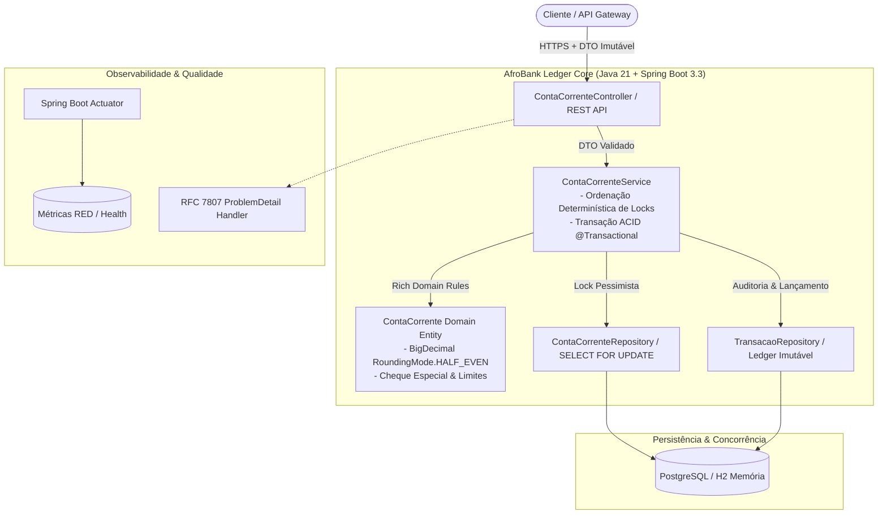

<div align="center">

# AfroBank Ledger

### Livro-Razão Financeiro com Concorrência Distribuída e Integridade Transacional

[](https://openjdk.org/)
[](https://spring.io/projects/spring-boot)
[](#esteiras-de-cicd-e-governanca)
[](LICENSE)

</div>

---

## Visão Geral

O **AfroBank Ledger** (`afrobank-ledger`) é o microsserviço de **livro-razão contábil e processamento transacional** do AfroBank. Construído sob princípios de **Clean Architecture**, **Domain-Driven Design (DDD)** e partidas dobradas (*double-entry bookkeeping*), o serviço assegura consistência dos saldos, prevenção contra *double spending* e eliminação de *deadlocks* em cenários de concorrência simultânea.

---

## Arquitetura do Serviço



---

## Engenharia de Concorrência e Consistência Financeira

### 1. Prevenção de Deadlocks por Ordenação Determinística de Recursos
Em transferências simultâneas entre contas cruzadas (ex: Thread 1 transfere de A para B; Thread 2 transfere de B para A), bloqueios adquiridos em ordem de chegada geram condições de travamento mútuo (*deadlocks*).
- **Solução no AfroBank Ledger:** Os bloqueios pessimistas (`SELECT FOR UPDATE`) são sempre adquiridos ordenados pelo menor identificador:
  $$\text{lock}(\min(id_A, id_B)) \longrightarrow \text{lock}(\max(id_A, id_B))$$
  Essa regra de ordenação previne entrelaçamento circular entre threads concorrentes.

### 2. Precisão Monetária
- **Eliminação de ponto flutuante:** Não são utilizados tipos `float` ou `double` para valores monetários.
- **`BigDecimal` com escala controlada:** Operações com duas casas decimais e modo de arredondamento bancário `RoundingMode.HALF_EVEN` (arredondamento para o par mais próximo, eliminando viés estatístico em operações sucessivas).

### 3. Partidas Dobradas e Rastreabilidade
- Toda mutação de saldo gera um registro correspondente na tabela `transacoes`, permitindo conciliação contábil e auditoria financeira.

### 4. Idempotência em Mutações Financeiras
- **Prevenção de duplicidade:** Suporte ao cabeçalho `X-Idempotency-Key` (UUIDv4) no endpoint de transferência.
- **Ciclo atômico:** A requisição registra a chave com status `PROCESSING` antes da transação e avança para `COMPLETED` após a conclusão. Requisições concorrentes ou repetidas com a mesma chave são interceptadas retornando HTTP 409 Conflict.

### 5. Transactional Outbox Pattern e Integração com Apache Kafka
- **Atomicidade banco-mensageria:** Para evitar falhas parciais de rede, o evento `TransferenciaRealizadaEvent` é persistido na tabela `outbox_events` na mesma transação SQL que atualiza os saldos.
- **Despacho assíncrono:** O `OutboxRelayService` lê os eventos pendentes e os despacha para o tópico `afrobank.transacoes.v1`. Em caso de falhas consecutivas, a mensagem é encaminhada para o tópico de contingência `afrobank.transacoes.dlq`.

---

## Esteiras de CI/CD e Governança

O repositório possui esteiras automatizadas multi-ambiente no **GitHub Actions**:


- **`ci.yml`**: Compilação, suíte de testes unitários e de integração com geração de relatórios Surefire e análise de dependências com **Trivy**.
- **`cd-dev.yml`**: Criação de imagem container Docker e deploy contínuo no ambiente de desenvolvimento.
- **`cd-hom.yml`**: Deploy em homologação com execução de testes de fumaça (*smoke tests*).
- **`cd-prod.yml`**: Release produtivo protegido por **Required Reviewers (aprovação manual)** no GitHub Environments.

---

## Pirâmide de Testes Automatizados

O projeto mantém cobertura automatizada dividida em camadas:

```
                  ┌──────────────────────┐
                  │    Controller Test   │  API MockMvc / RFC 7807 ProblemDetail
                  ├──────────────────────┤
                  │     Service Test     │  Mockito / Atomicidade & Locks
                  ├──────────────────────┤
                  │  Domain Entity Test  │  JUnit 5 + AssertJ / Precisão & Regras
                  └──────────────────────┘
```

Execução da suíte local:
```bash
./mvnw clean test
```

---

## Tecnologias Utilizadas

- **Linguagem e Framework:** Java 21 LTS, Spring Boot 3.3.5
- **Persistência:** Spring Data JPA, Hibernate, PostgreSQL, H2 Database (dev/test)
- **Segurança:** Spring Security Crypto (`BCryptPasswordEncoder`)
- **Qualidade e Testes:** JUnit 5, Mockito, AssertJ, Spring MockMvc
- **DevOps e Containers:** Docker (Multi-stage build non-root), GitHub Actions, Dependabot
- **Padrões Arquiteturais:** Clean Architecture, Domain-Driven Design (DDD), DTOs com Java Records imutáveis, RFC 7807 ProblemDetail

---

## Autoria

Desenvolvido por **Juliana Chaves Palm**  
[](https://linkedin.com/in/julianachavespalm)
[](https://github.com/julianachavespalm)
